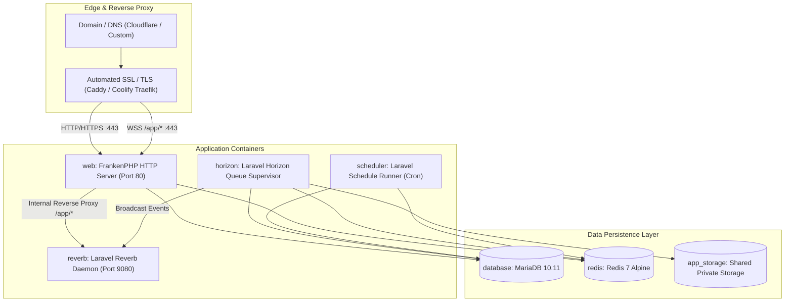

# Production Deployment & Infrastructure Guide

This guide details how to deploy `kcal-log` in production using **FrankenPHP**, **Laravel Horizon**, **Laravel Reverb**, **MariaDB**, and **Redis** across **Coolify** or any standard Linux VPS.

---

## 1. Production Architecture Overview



### Container Separation of Concerns
1. **`web`**: Runs **FrankenPHP** (Caddy + PHP 8.4) serving HTTP requests and internal reverse proxying for WebSocket frames (`/app/*`). Runs database migrations (`RUN_MIGRATIONS=true`) and builds production caches on boot.
2. **`horizon`**: Dedicated master supervisor managing Redis queue pools (`high`, `adaptive`, `exports`, `sync`) with auto-scaling and memory limits.
3. **`reverb`**: High-throughput asynchronous WebSocket daemon powered by the Revolt event loop.
4. **`scheduler`**: Lightweight daemon executing `php artisan schedule:work` for daily Open Food Facts catalog ingestion and weekly adaptive strategy regressions.
5. **`database`**: MariaDB 10.11+ using `utf8mb4_unicode_ci` and persistent volume.
6. **`redis`**: In-memory store for cache, session driver, and Horizon queue broker.

---

## 2. Deploying on Coolify

[Coolify](https://coolify.io) is an open-source, self-hosted PaaS. `kcal-log` provides a first-class compose configuration at [`docker-compose.coolify.yml`](file:///home/holako/github/kcal-log/docker-compose.coolify.yml).

### Step 1: Create a New Resource in Coolify
1. In your Coolify dashboard, select your **Project** and **Environment**.
2. Click **+ New Resource** $\rightarrow$ **Docker Compose**.
3. Select your GitHub repository (`DevHolako/kcal-log`) and branch (`main`).
4. Set the **Compose File Path** to `docker-compose.coolify.yml`.

### Step 2: Configure Environment Variables in Coolify UI
Add the following environment variables in the Coolify resource settings:

| Variable | Description | Example / Recommended Value |
| :--- | :--- | :--- |
| `APP_NAME` | Application title | `kcal-log` |
| `APP_ENV` | Environment identifier | `production` |
| `APP_KEY` | Laravel 32-byte encryption key | `base64:...` (Generate with `php artisan key:generate --show`) |
| `APP_DEBUG` | Detailed debug mode | `false` |
| `APP_URL` | Public production URL | `https://kcal.yourdomain.com` |
| `DB_DATABASE` | MariaDB database name | `kcal_log` |
| `DB_USERNAME` | Database user | `kcal_user` |
| `DB_PASSWORD` | Strong database password | `[Generate 32-char random string]` |
| `DB_ROOT_PASSWORD` | Strong MariaDB root password | `[Generate 32-char random string]` |
| `REDIS_PASSWORD` | Redis connection password | `[Generate 32-char random string]` |
| `REVERB_APP_ID` | WebSocket application ID | `kcal-log-id` |
| `REVERB_APP_KEY` | Public WebSocket key | `[Generate 20-char random key]` |
| `REVERB_APP_SECRET` | Secret WebSocket signature | `[Generate 32-char random key]` |
| `VITE_REVERB_HOST` | WebSocket client host | `kcal.yourdomain.com` |
| `VITE_REVERB_PORT` | WebSocket client port | `443` |
| `VITE_REVERB_SCHEME` | WebSocket transport scheme | `https` |
| `HORIZON_ADMIN_EMAILS` | Comma-separated admin emails | `admin@yourdomain.com` |

### Step 3: Deploy
Click **Deploy**. Coolify will build the multi-stage Docker image, initialize the MariaDB database and Redis store, run migrations, and launch all four application services.

---

## 3. Deploying with Docker Compose on a Standalone VPS

### Prerequisites
- Ubuntu 22.04 / 24.04 LTS or Debian 12
- Docker Engine 24.0+ and Docker Compose v2.20+
- Ports 80 and 443 open in firewall

### Deployment Steps

1. **Clone Repository**:
   ```bash
   git clone https://github.com/DevHolako/kcal-log.git /opt/kcal-log
   cd /opt/kcal-log
   ```

2. **Configure Environment**:
   ```bash
   cp docker/env.example .env
   # Edit .env and supply secure production keys
   nano .env
   ```

3. **Build & Start Services**:
   ```bash
   docker compose build
   docker compose up -d
   ```

4. **Verify Health**:
   ```bash
   docker compose ps
   docker compose logs -f web
   ```

---

## 4. WebSocket Routing (Reverb over HTTPS)

To allow client browsers to connect via standard `wss://` without opening custom ports in firewalls or cloud security groups, the included [`docker/Caddyfile`](file:///home/holako/github/kcal-log/docker/Caddyfile) proxies all `/app/*` requests directly to the internal `reverb` container on port 9080:

```caddyfile
{$SERVER_NAME::80} {
    root * /app/apps/web/public
    encode zstd gzip

    # Reverse proxy Reverb WebSockets
    @websockets {
        path /app/*
    }
    handle @websockets {
        reverse_proxy {$REVERB_HOST:reverb}:{$REVERB_SERVER_PORT:9080}
    }

    # Static Asset Caching
    @static {
        file
        path *.ico *.css *.js *.gif *.webp *.avif *.jpg *.jpeg *.png *.svg *.woff *.woff2
    }
    header @static Cache-Control "public, max-age=31536000, immutable"

    # Route dynamic requests through FrankenPHP
    php_server
}
```

---

## 5. Horizon Dashboard Security

The Laravel Horizon monitoring dashboard is located at `/horizon`. Access is secured by [`HorizonServiceProvider.php`](file:///home/holako/github/kcal-log/apps/web/app/Providers/HorizonServiceProvider.php):
- Only authenticated users whose email is listed in `HORIZON_ADMIN_EMAILS` or have `is_admin = true` can access the telemetry metrics and queue control plane.

---

## 6. Backup and Maintenance

### Automated MariaDB Dump
Add a daily cron job to the host system:
```bash
# /etc/cron.daily/kcal-log-backup
docker compose -f /opt/kcal-log/docker-compose.yml exec -T database \
  mariadb-dump -u kcal_user -p"$DB_PASSWORD" kcal_log \
  | gzip > /var/backups/kcal-log-$(date +\%F).sql.gz
```

### Updating to New Releases
```bash
cd /opt/kcal-log
git pull origin main
docker compose build --pull
docker compose up -d
```
The `entrypoint.sh` automatically runs `php artisan migrate --force` and warms all Laravel caches on the `web` container.
